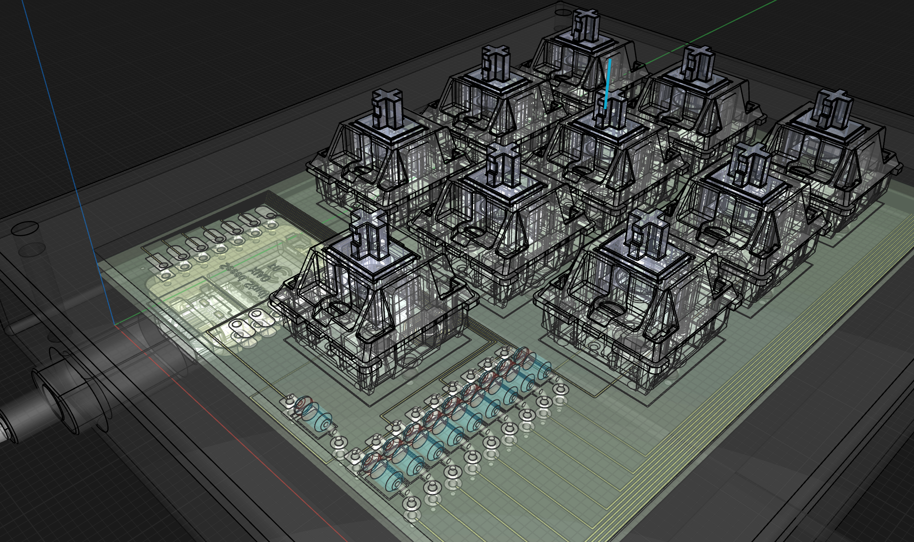
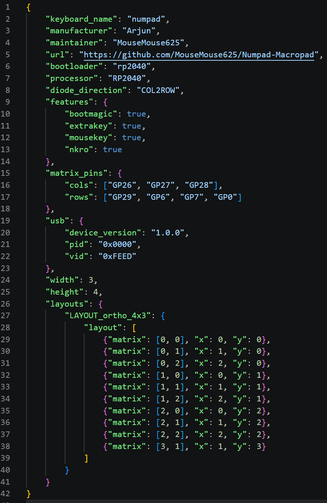
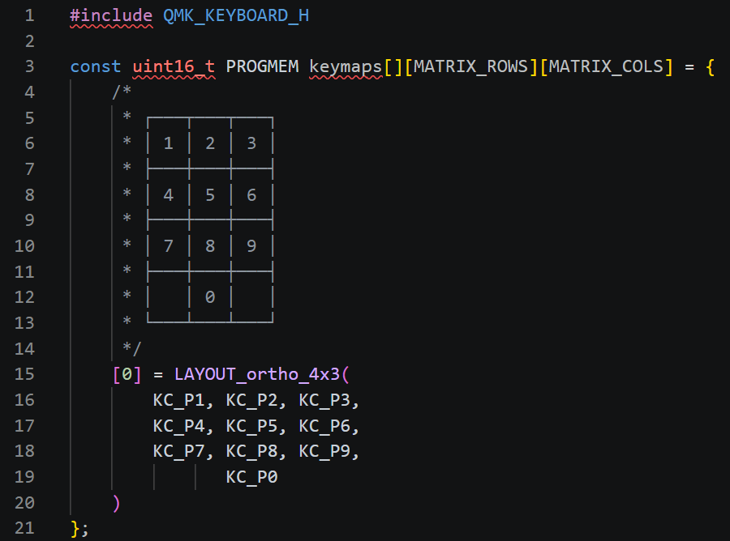

# Numpad

>   self-explanatory.

## Description

Numpad is a [Macropad](https://www.google.com/search?q=Macropad), a custom sort of mini-keyboard usually designed for faster inputting of hardcoded shortcuts/strings or specific functions. However, this macropad is made as a [Numpad](https://www.google.com/search?q=Numpad) accessory for inputting an assortment of [Unicode](https://www.google.com/search?q=Unicode) characters.

This project is made possible by [Hackpad](https://www.google.com/search?q=Hackpad+for+Hack+Club), a YSWS (you ship we ship) event on making a custom Macropad run by [Hack Club](https://www.google.com/search?q=Hack+Club).

## Features

### Physical Features

- 10 keys numbered 0 through 9
- 3D printed case
- Custom PCB in a [Sandwich Mount](https://www.google.com/search?q=Sandwich+Mount)

### Repository Features

- KiCad design files
    - Project files
    - Schematics
    - PCB files
- CAD mockup
    - PCB
        - Components
            - Keyswitches
            - Diodes
            - XIAO
        - The actual PCB
    - Case
        - Main body
        - Top plate
    - Cable (useful for an appropriate opening for power)
- QMK firmware

## Renderings

>   we all know you love them.

### PCB

      

### CAD

### Code

>   not orthodox "renderings", but they look cool.

### Photos

>   DEFINITELY not renderings.

<Insert Images>

## Contributions

Do you have any suggestions, fixes, or extensions? If so, you can submit a pull request on this [Repository](https://github.com/MouseMouse625/Numpad).

## Credits

Credits to HCB, Stardance and Hackpad for the initiation of this project. Further thanks to various other projects also made for Hackpad which I referenced and took inspiration from.

## License

This project uses the MIT License stating that the project is open source and free for anyone to use or develop. For more info, navigate to the [LICENSE.md](https://github.com/MouseMouse625/Numpad/blob/main/LICENSE.md) file.

---

Copyright © 2025 Numpad
