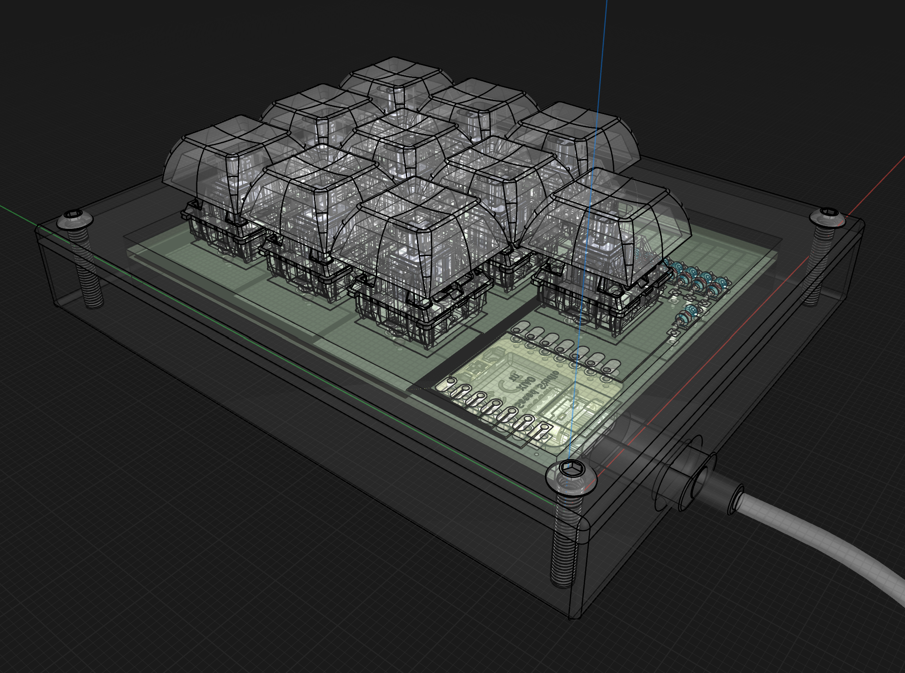
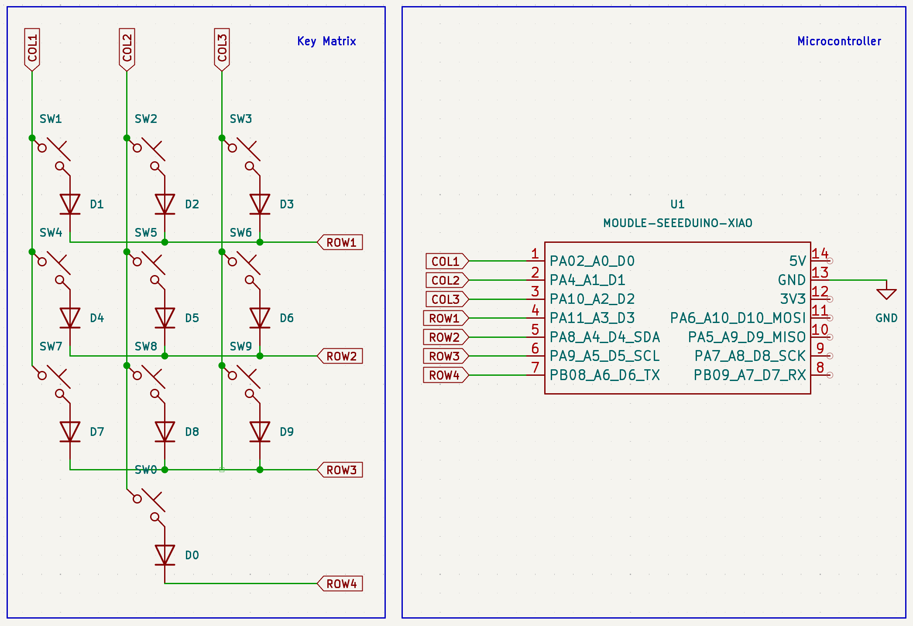
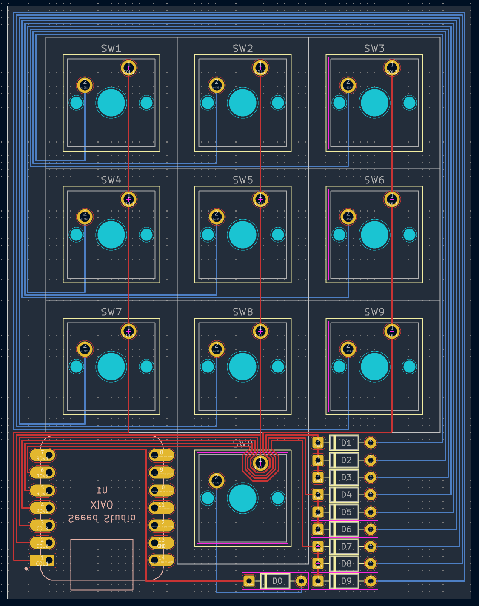
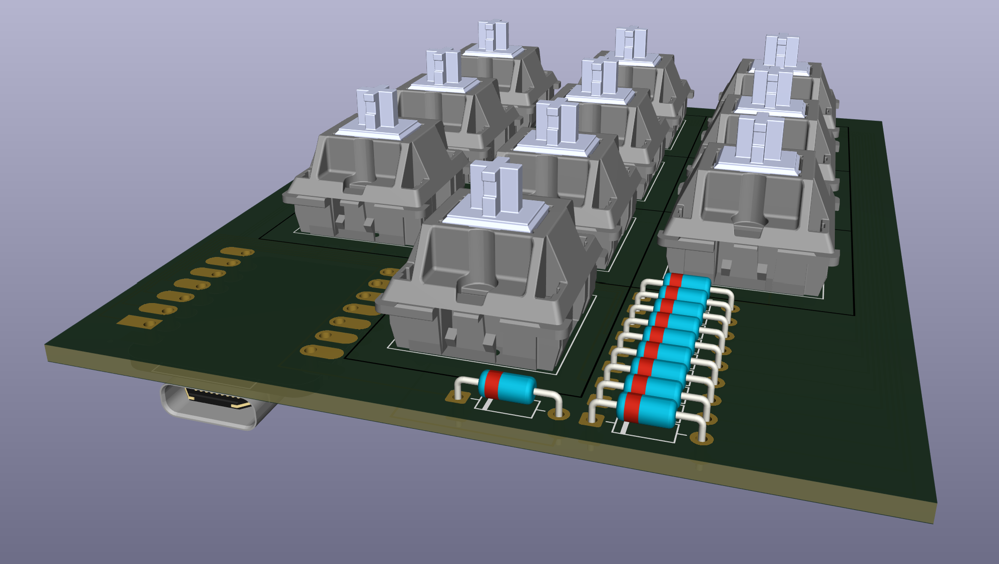
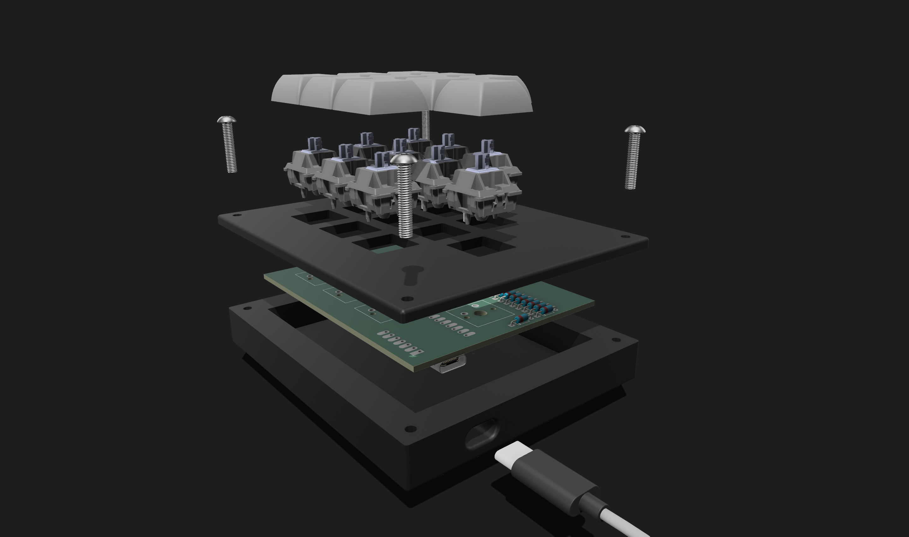
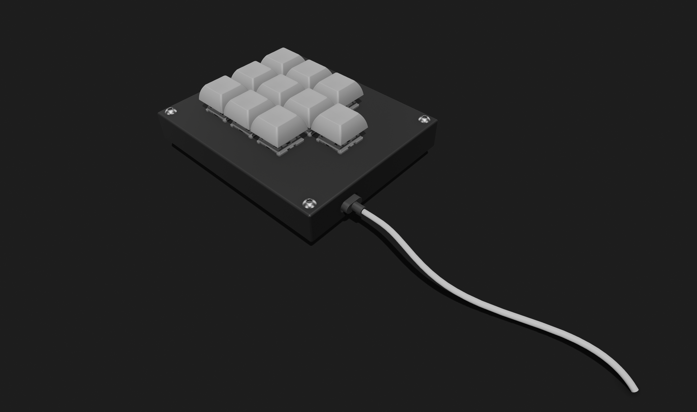
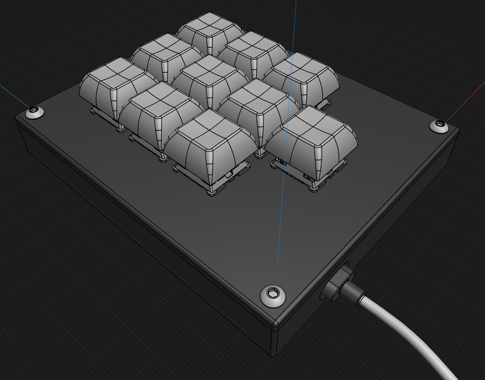
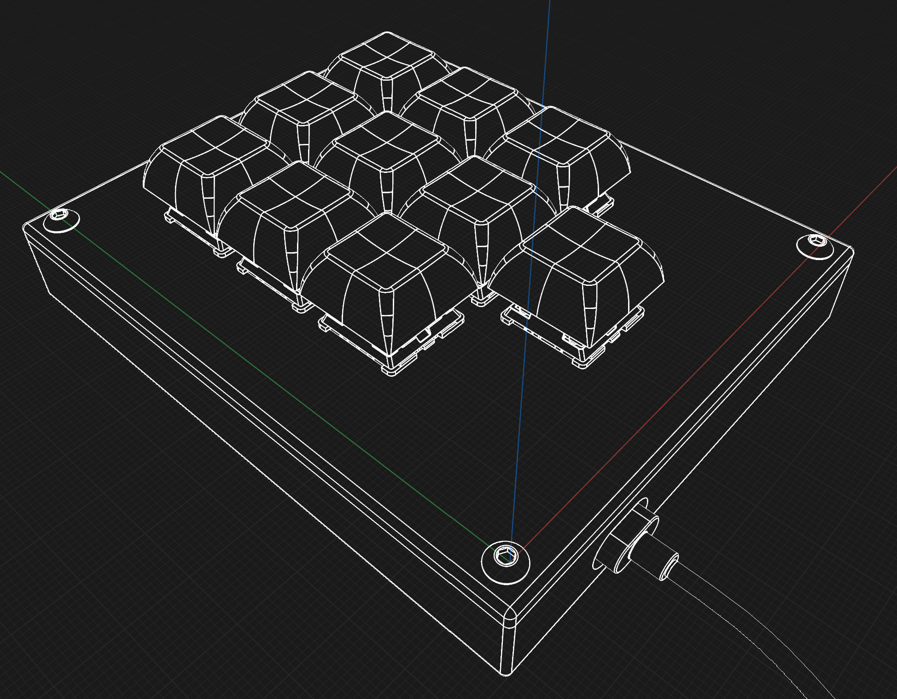

# Numpad

>   self-explanatory, a custom macropad functioning as a numpad.



## Description

Numpad is a [Macropad](https://www.google.com/search?q=Macropad), a custom sort of mini-keyboard usually designed for faster inputting of hardcoded shortcuts/strings or specific functions. However, this macropad is made as a [Numpad](https://www.google.com/search?q=Numpad) accessory for inputting an assortment of [Unicode](https://www.google.com/search?q=Unicode) characters.

This project is made possible by [Hackpad](https://www.google.com/search?q=Hackpad+for+Hack+Club), a YSWS (you ship we ship) event on making a custom Macropad run by [Hack Club](https://www.google.com/search?q=Hack+Club).

## Features

### Physical Features

- 10 keys numbered 0 through 9
- 3D printed case
- Custom PCB in a [Sandwich Mount](https://www.google.com/search?q=Sandwich+Mount)

### Repository Features

- KiCad design files
    - Project files
    - Schematics
    - PCB files
- CAD mockup
    - PCB
        - Components
            - Keyswitches
            - Diodes
            - XIAO
        - The actual PCB
    - Case
        - Main body
        - Top plate
    - Cable (useful for an appropriate opening for power)
- QMK firmware

## Renderings

>   we all know you love them.

<!--
# Image Row Alignment Guide

### Core Mathematical Formulation

Given a row containing $n$ distinct images, let each image $i \in \{1, 2, \dots, n\}$ possess an intrinsic width $W_i \in \mathbb{R}^+$ and an intrinsic height $H_i \in \mathbb{R}^+$ measured in pixels.

#### 1. Image Aspect Ratio ($R_i$)
The dimensional aspect ratio for an individual image element $i$ is defined as:
$$R_i = \frac{W_i}{H_i}$$

#### 2. Combined Row Share ($\mathcal{S}$)
The aggregate dimensional proportion of the horizontal row sequence is the summation of all individual component ratios:
$$\mathcal{S} = \sum_{i=1}^{n} R_i$$

#### 3. Normalized Image Width Percentage ($P_i$)
To constrain the horizontal sequence to exactly 100% of the parent viewport width container while enforcing a uniform visual height baseline across the row, the relative percentage allocation $P_i$ for each image $i$ is formulated as:
$$P_i = \left( \frac{R_i}{\mathcal{S}} \right) \times 100 = \left( \frac{\frac{W_i}{H_i}}{\sum_{j=1}^{n} \frac{W_j}{H_j}} \right) \times 100$$

---

### Code Architecture Templates

#### Single-Row Configuration
```html
<p align="center"></p>
```

#### Multi-Row Compact Configuration
```html
<p align="center">
  
  <br style="line-height: 5px;" />
  
</p>
```
-->

### PCB

<p align="center"></p>

### CAD

>   one assembly image (the others are mostly for eye-candy).

<p align="center">
  
  <br style="line-height: 5px;"/>
  
</p>

### Photos

>   not exactly orthodox "renderings".

// Images of the finished product

## Assembly

### BoM

>   the parts.

- 1x custom-built `PCB`
- 1x unsoldered `Seeed XIAO RP2040`
- 10x through-hole `1N4148 Diodes`
- 10x `MX-Style switches`
- 10x white blank `DSA Keycaps`
- 4x `M3x16mm Screws`
- 1x 3D-printed `Case`
    - 1x 3D-printed `Bottom Section`
    - 1x 3D-printed `Top Section`

>   the tools.

- 1x `Soldering Iron`
- 1x roll of (with a decent amount left) `Solder`
- 1x tool for clipping pins (either/or)
    - 1x (optional) pair of `Wirecutters`
    - 1x (optional) pair of `Scissors`
- 1x `Flashing Setup` for...flashing
    - 1x USB-C `Cable` (for power too)
    - 1x functioning `Computer`
- 1x (optional) functioning `3D Printer` 
- 1x (optional) full-fledged `Factory` for making PCBs
    - 1x `CNC Router`
    - 1x `Laser Plotter`
    - 1x `Chemical Etcher`
    - 1x `Plating System`
    - 1x `Silkscreen Printer`
- 1x functioning [`Encephalon`](https://www.google.com/search?q=Encephalon)

### Instructions

// help me

## Contributions

Do you have any suggestions, fixes, or extensions? If so, you can submit a pull request on this [Repository](https://github.com/MouseMouse625/Numpad).

## Credits

Credits to:
- `HCB` for hosting this whole thing
    - `Stardance` for running an actual summer event
        - `Hackpad` for inspiration on this specific project
            - `mani` for their schematics made for Spacepad as a reference on [Matrix Wiring](https://www.google.com/search?q=Matrix+Wiring)
            - `codecraft07` for making Stream Deck act as a reference for finding the correct DSA keycap models (turns out it was in the parts list that I wrote, so...yeah)
            - `cheyao` for creating the guides
- `GrabCAD` for their open-source CAD models of various parts
    - `kevin.yu-7` for their models of the Cherry MX Keyswitches
    - `mirac.gulgonul-1` for their model of the Seeed Studio XIAO RP2040
    - `chris.barnado-1` for their model of the flexed USB-C Cable
    - `zim.cad-1` for their models of the blank white DSA Keycaps
- `McMaster-Carr` for their huge library of various models, most importantly the M3x16 screws
- `Shapr3D`, `VSCode` and `KiCad` for making the CAD section of all of this possible
- `Google` for acting as a universal search engine for all of my dumb querie

## License

This project uses the MIT License stating that the project is open source and free for anyone to use or develop. For more info, navigate to the [LICENSE.md](https://github.com/MouseMouse625/Numpad/blob/main/LICENSE.md) file.

---

Copyright © 2025 Numpad
